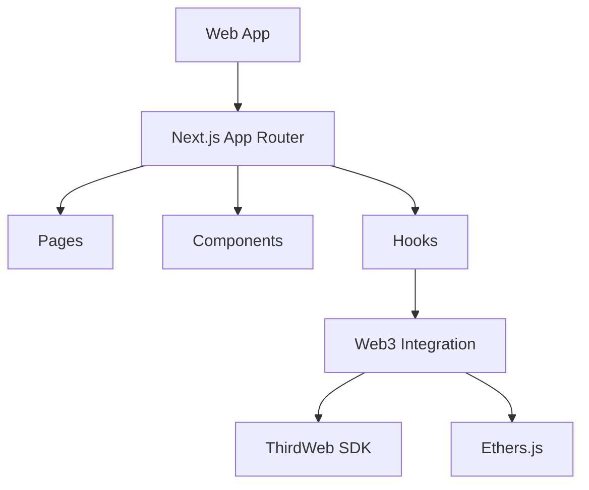
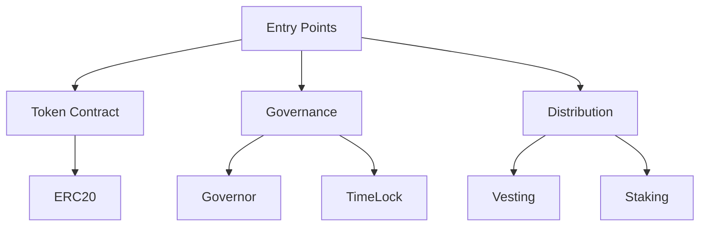

# Encrypia ICO Platform - Technical Documentation

## System Architecture

### Frontend Architecture



### Smart Contract Architecture



## Core Components

### Token System

- **ICOToken.sol**: Main ERC20 token implementation
- **Vesting.sol**: Token vesting logic
- **Distribution.sol**: Airdrop and reward distribution

### Governance System

- **Governor.sol**: DAO governance implementation
- **TimeLock.sol**: Time-locked execution
- **Voting.sol**: Token-weighted voting

### Frontend Components

```typescript
components/
├── dashboard/
│   ├── ClaimableTokens.tsx    // Token claim interface
│   ├── InvestmentSummary.tsx  // Investment tracking
│   ├── TokenBalance.tsx       // Balance display
│   └── VestingChart.tsx       // Vesting visualization
├── governance/
│   ├── ProposalList.tsx       // Proposal management
│   ├── VotingInterface.tsx    // Voting interface
│   └── DelegateVotes.tsx      // Vote delegation
└── ico/
    ├── ParticipationForm.tsx  // ICO participation
    ├── TierSystem.tsx         // Investment tiers
    └── WhitelistStatus.tsx    // Whitelist checking
```

## API Endpoints

### Distribution API

```typescript
/api/distribution
GET  - Get distribution info
POST - Claim tokens

/api/whitelist
GET  - Check whitelist status
POST - Add to whitelist

/api/proposals
GET  - List proposals
POST - Create proposal
```

## State Management

### Zustand Store Structure

```typescript
interface StoreState {
  user: {
    address: string;
    balance: string;
    vestingInfo: VestingInfo;
  };
  ico: {
    phase: IcoPhase;
    stats: IcoStats;
  };
  governance: {
    proposals: Proposal[];
    userVotes: number;
  };
}
```

## Environment Configuration

### Required Variables

```env
NEXT_PUBLIC_CHAIN_ID=11155111
NEXT_PUBLIC_RPC_URL=your-rpc-url
NEXT_PUBLIC_TOKEN_CONTRACT=your-token-contract
NEXT_PUBLIC_STAKING_CONTRACT=your-staking-contract
ADMIN_PRIVATE_KEY=your-admin-private-key
```

## Development Commands

### Smart Contract Development

```bash
# Test contracts
forge test --gas-report
forge test --fork-url $RPC_URL

# Deploy contracts
forge script script/Deploy.s.sol:Deploy --rpc-url $RPC_URL --broadcast

# Generate docs
forge doc
```

### Frontend Development

```bash
# Development
pnpm dev

# Testing
pnpm test
pnpm test:e2e

# Build
pnpm build
```

## Security Considerations

### Smart Contract Security

- Role-based access control
- Time-locked operations
- Emergency pause functionality
- Re-entrancy protection
- Integer overflow protection

### Frontend Security

- Input validation
- Rate limiting
- Transaction confirmation
- Wallet connection validation
- API route protection

`````

Now, let's create the AI-focused documentation:

````markdown
// filepath: /mnt/c/work/encrypia/ico-platform/frontend/doc/ai_context.md
# Encrypia ICO Platform - AI Context Model

## Project Overview
{
  "project_type": "Web3 Platform",
  "primary_function": "ICO Launch and Management",
  "technology_stack": {
    "frontend": ["Next.js", "TypeScript", "Tailwind"],
    "blockchain": ["Ethereum", "Solidity", "Foundry"],
    "integrations": ["ThirdWeb", "Ethers.js"]
  }
}

## Core Functionalities
{
  "user_roles": [
    {
      "role": "Investor",
      "capabilities": [
        "Participate in ICO",
        "Track investments",
        "Claim tokens",
        "Vote on proposals"
      ]
    },
    {
      "role": "Creator",
      "capabilities": [
        "Configure ICO",
        "Manage distribution",
        "Set parameters",
        "Monitor stats"
      ]
    }
  ]
}

## System Components
{
  "smart_contracts": {
    "token": {
      "standard": "ERC20",
      "features": ["Vesting", "Staking", "Governance"]
    },
    "governance": {
      "type": "DAO",
      "mechanism": "Token-weighted voting"
    },
    "distribution": {
      "methods": ["ICO", "Airdrop", "Vesting"]
    }
  }
}

## Data Models
{
  "user": {
    "address": "string",
    "balance": "BigNumber",
    "tier": "number",
    "vestingSchedule": "VestingInfo[]"
  },
  "proposal": {
    "id": "string",
    "title": "string",
    "votes": {
      "for": "BigNumber",
      "against": "BigNumber",
      "abstain": "BigNumber"
    }
  }
}

## Integration Points
{
  "blockchain_interactions": [
    "Token transfers",
    "Governance votes",
    "Staking operations",
    "Distribution claims"
  ],
  "external_services": [
    "Web3 wallet providers",
    "Price oracles",
    "KYC providers"
  ]
}

## Context Instructions
{
  "development_approach": {
    "component_creation": "Use TypeScript with React functional components",
    "styling": "Apply Tailwind CSS using dark theme classes",
    "state_management": "Implement Zustand stores for global state"
  },
  "code_generation": {
    "components": "Follow atomic design principles",
    "smart_contracts": "Include NATSPEC documentation",
    "testing": "Write unit tests for all components"
  }
}

## Response Guidelines
{
  "code_formatting": {
    "typescript": "Use strict type checking",
    "solidity": "Follow latest style guide",
    "components": "Include prop types and comments"
  },
  "documentation": {
    "comments": "Provide clear function descriptions",
    "examples": "Include usage examples",
    "types": "Define all interfaces and types"
  }
}

## Error Handling
{
  "frontend": {
    "user_feedback": "Show toast notifications",
    "loading_states": "Display loading indicators",
    "error_boundaries": "Implement React error boundaries"
  },
  "smart_contracts": {
    "require_statements": "Use descriptive error messages",
    "modifiers": "Implement access control checks",
    "events": "Emit detailed event logs"
  }
}

## Project Conventions
{
  "naming": {
    "components": "PascalCase",
    "functions": "camelCase",
    "constants": "UPPER_CASE",
    "files": "kebab-case"
  },
  "folder_structure": {
    "components": "Group by feature",
    "hooks": "Prefix with 'use'",
    "utils": "Group by functionality"
  }
}
`````

These documents provide:

1. **technical.md**:

   - Detailed system architecture
   - Component structure
   - API documentation
   - Development commands
   - Security considerations

2. **ai_context.md**:
   - JSON-like structure for AI parsing
   - Clear context models
   - Development guidelines
   - Project conventions
   - Integration points

You can create these files using:

```bash
mkdir -p /mnt/c/work/encrypia/ico-platform/frontend/doc
touch /mnt/c/work/encrypia/ico-platform/frontend/doc/{technical.md,ai_context.md}
```

Both documents will help developers and AI assistants understand and work with the project effectively.// filepath: /mnt/c/work/encrypia/ico-platform/frontend/doc/technical.md

# Encrypia ICO Platform - Technical Documentation

## System Architecture

### Frontend Architecture


### Smart Contract Architecture


## Core Components

### Token System

- **ICOToken.sol**: Main ERC20 token implementation
- **Vesting.sol**: Token vesting logic
- **Distribution.sol**: Airdrop and reward distribution

### Governance System

- **Governor.sol**: DAO governance implementation
- **TimeLock.sol**: Time-locked execution
- **Voting.sol**: Token-weighted voting

### Frontend Components

```typescript
components/
├── dashboard/
│   ├── ClaimableTokens.tsx    // Token claim interface
│   ├── InvestmentSummary.tsx  // Investment tracking
│   ├── TokenBalance.tsx       // Balance display
│   └── VestingChart.tsx       // Vesting visualization
├── governance/
│   ├── ProposalList.tsx       // Proposal management
│   ├── VotingInterface.tsx    // Voting interface
│   └── DelegateVotes.tsx      // Vote delegation
└── ico/
    ├── ParticipationForm.tsx  // ICO participation
    ├── TierSystem.tsx         // Investment tiers
    └── WhitelistStatus.tsx    // Whitelist checking
```

## API Endpoints

### Distribution API

```typescript
/api/distribution
GET  - Get distribution info
POST - Claim tokens

/api/whitelist
GET  - Check whitelist status
POST - Add to whitelist

/api/proposals
GET  - List proposals
POST - Create proposal
```

## State Management

### Zustand Store Structure

```typescript
interface StoreState {
  user: {
    address: string;
    balance: string;
    vestingInfo: VestingInfo;
  };
  ico: {
    phase: IcoPhase;
    stats: IcoStats;
  };
  governance: {
    proposals: Proposal[];
    userVotes: number;
  };
}
```

## Environment Configuration

### Required Variables

```env
NEXT_PUBLIC_CHAIN_ID=11155111
NEXT_PUBLIC_RPC_URL=your-rpc-url
NEXT_PUBLIC_TOKEN_CONTRACT=your-token-contract
NEXT_PUBLIC_STAKING_CONTRACT=your-staking-contract
ADMIN_PRIVATE_KEY=your-admin-private-key
```

## Development Commands

### Smart Contract Development

```bash
# Test contracts
forge test --gas-report
forge test --fork-url $RPC_URL

# Deploy contracts
forge script script/Deploy.s.sol:Deploy --rpc-url $RPC_URL --broadcast

# Generate docs
forge doc
```

### Frontend Development

```bash
# Development
pnpm dev

# Testing
pnpm test
pnpm test:e2e

# Build
pnpm build
```

## Security Considerations

### Smart Contract Security

- Role-based access control
- Time-locked operations
- Emergency pause functionality
- Re-entrancy protection
- Integer overflow protection

### Frontend Security

- Input validation
- Rate limiting
- Transaction confirmation
- Wallet connection validation
- API route protection
